<!-- ═══════════════════════════════════════════════════════ HEADER ═══════════════════════════════════════════════════════ -->

<a href="https://msprojects.online/">
  
</a>

<br/><br/>

<p align="center">
  <a href="https://msprojects.online/"></a>
  &nbsp;
  <a href="https://github.com/Zariffs?tab=repositories"></a>
  &nbsp;
  
  &nbsp;
  
</p>

<br/>

<!-- ═══════════════════════════════════════════════════════ 01 · ABOUT ═══════════════════════════════════════════════════════ -->

<picture>
  <source media="(prefers-color-scheme: dark)" srcset="./assets/section-01-dark.svg"/>
  <source media="(prefers-color-scheme: light)" srcset="./assets/section-01-light.svg"/>
  
</picture>

<table width="100%">
  <tr>
    <td width="58%" valign="top">
      <br/>
      <samp>
        I'm Matt — a <b>Roblox developer</b> from Australia.<br/><br/>
        Most of my time goes into building games in <b>Roblox Studio</b> with <b>Lua / Luau</b>:
        gameplay systems, UI, and everything that makes a game feel good to play.<br/><br/>
        On the side, I trade <b>XAUUSD</b> (gold).
      </samp>
      <br/><br/>
    </td>
    <td width="42%" valign="top">

```lua
local Matt = {
    role     = "Roblox Developer",
    location = "Australia",
    builds   = { "games", "systems", "ui" },
    language = "Luau",
    trades   = "XAUUSD",
    ai_usage = "minimal",
    site     = "msprojects.online",
}

return Matt
```

</td>
  </tr>
</table>

<br/>

<!-- ═══════════════════════════════════════════════════════ 02 · ROBLOX ═══════════════════════════════════════════════════════ -->

<picture>
  <source media="(prefers-color-scheme: dark)" srcset="./assets/section-02-dark.svg"/>
  <source media="(prefers-color-scheme: light)" srcset="./assets/section-02-light.svg"/>
  
</picture>

<table width="100%">
  <tr>
    <td width="33%" valign="top">
      <h4><samp>[ gameplay ]</samp></h4>
      <samp>
        → Core game loops<br/>
        → Player systems<br/>
        → Server / client logic
      </samp>
      <br/><br/>
    </td>
    <td width="33%" valign="top">
      <h4><samp>[ interface ]</samp></h4>
      <samp>
        → In-game UI<br/>
        → Menus &amp; HUDs<br/>
        → Feel &amp; polish
      </samp>
      <br/><br/>
    </td>
    <td width="33%" valign="top">
      <h4><samp>[ studio ]</samp></h4>
      <samp>
        → Roblox Studio<br/>
        → Lua &amp; Luau scripting<br/>
        → Building &amp; testing
      </samp>
      <br/><br/>
    </td>
  </tr>
</table>

<br/>

<!-- ═══════════════════════════════════════════════════════ 03 · STACK ═══════════════════════════════════════════════════════ -->

<picture>
  <source media="(prefers-color-scheme: dark)" srcset="./assets/section-03-dark.svg"/>
  <source media="(prefers-color-scheme: light)" srcset="./assets/section-03-light.svg"/>
  
</picture>

<br/>

<p align="center">
  
  &nbsp;
  
  &nbsp;
  
</p>

<br/>

<!-- ═══════════════════════════════════════════════════════ 04 · TRADING ═══════════════════════════════════════════════════════ -->

<picture>
  <source media="(prefers-color-scheme: dark)" srcset="./assets/section-04-dark.svg"/>
  <source media="(prefers-color-scheme: light)" srcset="./assets/section-04-light.svg"/>
  
</picture>

<table width="100%">
  <tr>
    <td width="70%" valign="top">
      <br/>
      <samp>
        Outside of Roblox, I trade <b>XAUUSD</b> — spot gold.<br/><br/>
        It's hands-on trading, not code: I read the charts and make the calls myself.
      </samp>
      <br/><br/>
    </td>
    <td width="30%" valign="middle" align="center">
      
      <br/>
      
    </td>
  </tr>
</table>

<br/>

<!-- ═══════════════════════════════════════════════════════ 05 · ON AI ═══════════════════════════════════════════════════════ -->

<picture>
  <source media="(prefers-color-scheme: dark)" srcset="./assets/section-05-dark.svg"/>
  <source media="(prefers-color-scheme: light)" srcset="./assets/section-05-light.svg"/>
  
</picture>

<table width="100%">
  <tr>
    <td width="100%">
      <br/>
      <samp>
        AI plays a minimal role in how I work.<br/><br/>
        The games and systems on this profile are scripted, debugged and tested by me.
        I'd rather understand every line I ship than paste in code I can't explain.<br/><br/>
        When I do use AI, it's for small things — looking something up faster, or a second opinion on wording.
        Never for the core of a game.
      </samp>
      <br/><br/>
    </td>
  </tr>
</table>

<br/>

<!-- ═══════════════════════════════════════════════════════ 06 · ACTIVITY ═══════════════════════════════════════════════════════ -->

<picture>
  <source media="(prefers-color-scheme: dark)" srcset="./assets/section-06-dark.svg"/>
  <source media="(prefers-color-scheme: light)" srcset="./assets/section-06-light.svg"/>
  
</picture>

<picture>
  <source media="(prefers-color-scheme: dark)" srcset="https://raw.githubusercontent.com/Zariffs/zariffs/output/activity-dark.svg"/>
  <source media="(prefers-color-scheme: light)" srcset="https://raw.githubusercontent.com/Zariffs/zariffs/output/activity-light.svg"/>
  
</picture>

<br/>

<!-- ═══════════════════════════════════════════════════════ FOOTER ═══════════════════════════════════════════════════════ -->

<picture>
  <source media="(prefers-color-scheme: dark)" srcset="./assets/footer-dark.svg"/>
  <source media="(prefers-color-scheme: light)" srcset="./assets/footer-light.svg"/>
  
</picture>
