<!--
  ███╗   ███╗ █████╗ ████████╗████████╗    ███████╗
  ████╗ ████║██╔══██╗╚══██╔══╝╚══██╔══╝    ██╔════╝
  ██╔████╔██║███████║   ██║      ██║       ███████╗
  ██║╚██╔╝██║██╔══██║   ██║      ██║       ╚════██║
  ██║ ╚═╝ ██║██║  ██║   ██║      ██║       ███████║
  ╚═╝     ╚═╝╚═╝  ╚═╝   ╚═╝      ╚═╝       ╚══════╝
  github.com/Zariffs · msprojects.online
-->

<!-- ════════════════════════════════════════════ HEADER ════════════════════════════════════════════ -->

 

<table width="100%">
  <tr>
    <td width="25%" align="center">
      
    </td>
    <td width="25%" align="center">
      
    </td>
    <td width="25%" align="center">
      
    </td>
    <td width="25%" align="center">
      
    </td>
  </tr>
</table>

 

<!-- ════════════════════════════════════════════ 01 · ABOUT ════════════════════════════════════════════ -->

 

<table width="100%">
  <tr>
    <td width="60%" valign="top">
       
      <samp>
        I'm Matt — a developer from Australia.  
        I build games on <b>Roblox</b> in Lua, write applications in <b>C</b>,
        and spend a lot of time pulling apart <b>x86 / x64</b> binaries to see how they really work.  
        Outside of code I trade <b>XAUUSD</b> (gold), and build and test my own trading tools
        in <b>MQL5</b> and <b>Pine Script</b>.
      </samp>
        
    </td>
    <td width="40%" valign="top">
<pre>
<samp>
const matt = {
  location : "Australia",
  building : ["roblox games",
              "c applications"],
  reversing: ["x86", "x64"],
  trading  : "XAUUSD",
  platforms: ["MT5", "TradingView"],
  ai_usage : "minimal",
  site     : "msprojects.online",
};
</samp>
</pre>
    </td>
  </tr>
</table>

 

<!-- ════════════════════════════════════════════ 02 · FOCUS ════════════════════════════════════════════ -->

 

<table width="100%">
  <tr>
    <td width="33%" valign="top" align="left">
      <h4><samp>[ game dev ]</samp></h4>
      <samp>
        → Roblox / Roblox Studio 
        → Lua &amp; Luau 
        → Gameplay systems 
        → UI &amp; tooling
      </samp>
        
    </td>
    <td width="33%" valign="top" align="left">
      <h4><samp>[ low level ]</samp></h4>
      <samp>
        → Application dev in C 
        → x86 &amp; x64 assembly 
        → Reverse engineering 
        → Debugging &amp; analysis
      </samp>
        
    </td>
    <td width="33%" valign="top" align="left">
      <h4><samp>[ trading ]</samp></h4>
      <samp>
        → XAUUSD (spot gold) 
        → MQL5 expert advisors 
        → Pine Script indicators 
        → Backtesting &amp; risk management
      </samp>
        
    </td>
  </tr>
</table>

 

<!-- ════════════════════════════════════════════ 03 · STACK ════════════════════════════════════════════ -->

 

<table width="100%">
  <tr>
    <td width="20%" valign="middle"><samp><b>languages</b></samp></td>
    <td width="80%">
      
      
      
      
      
      
    </td>
  </tr>
  <tr>
    <td width="20%" valign="middle"><samp><b>game dev</b></samp></td>
    <td width="80%">
      
      
    </td>
  </tr>
  <tr>
    <td width="20%" valign="middle"><samp><b>web</b></samp></td>
    <td width="80%">
      
      
      
      
      
      
    </td>
  </tr>
  <tr>
    <td width="20%" valign="middle"><samp><b>trading</b></samp></td>
    <td width="80%">
      
      
      
      
      
    </td>
  </tr>
  <tr>
    <td width="20%" valign="middle"><samp><b>tools</b></samp></td>
    <td width="80%">
      
      
      
      
    </td>
  </tr>
</table>

 

<!-- ════════════════════════════════════════════ 04 · ON AI ════════════════════════════════════════════ -->

 

<table width="100%">
  <tr>
    <td width="100%">
       
      <samp>
        AI plays a minimal role in how I work.  
        The games, applications and trading tools on this profile are written, debugged and tested by me.
        I'd rather understand every line I ship — especially in reverse engineering and trading,
        where not knowing why something works is how you get burned.  
        When I do use AI, it's for small things: looking something up faster, or a second opinion on wording.
        Never for the core logic.
      </samp>
        
    </td>
  </tr>
</table>

 

<!-- ════════════════════════════════════════════ 05 · ACTIVITY ════════════════════════════════════════════ -->

 

<picture>
  <source media="(prefers-color-scheme: dark)" srcset="https://raw.githubusercontent.com/Zariffs/Zariffs/output/activity.svg"/>
  <source media="(prefers-color-scheme: light)" srcset="https://raw.githubusercontent.com/Zariffs/Zariffs/output/activity-light.svg"/>
  
</picture>

  

<!-- ════════════════════════════════════════════ FOOTER ════════════════════════════════════════════ -->

